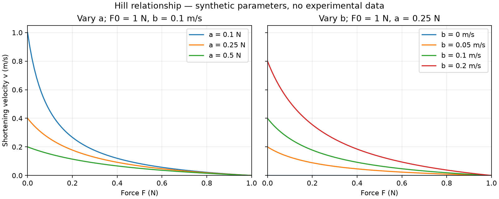

# Chapter 1 — Understanding the Hill force–velocity relationship

**Reading goal:** follow one equation from a scientific source through an informal
mathematical argument to a checked Lean statement. No calculus is needed.

Read this chapter first, then explore [the notebook](../../notebooks/hill-exploration.ipynb).
The notebook changes parameters and draws curves; the [Lean module](../../CardioLean/Contraction/Hill.lean)
contains the universal mathematical proofs. The [journal questions](../../journal/002-hill-model.md)
are prompts for personal study, not claims of understanding.

## 1. Scientific source

[Hill1938](../../REFERENCES.md): A. V. Hill, *The heat of shortening and the
dynamic constants of muscle* (1938), Proceedings of the Royal Society of London,
Series B, 126(843), 136–195. DOI:
[10.1098/rspb.1938.0050](https://doi.org/10.1098/rspb.1938.0050).

The relationship appears on **printed p. 161, equations (1) and (2)** (page 26
of the [original PDF scan](https://math.nyu.edu/~peskin/eb_lecture_notes/Hill_AV_1938.pdf)).
The original notation `P`, `P₀` becomes `F`, `F₀` here. The units of `a` and `b`
are discussed on printed pp. 160–161. Equation and metadata checked 2026-11-05.

## 2. Biological interpretation

The expression relates a muscle's load to its shortening speed. Positive `v`
means shortening; isometric means no change of length. In this exercise `F₀`
is the maximum isometric force parameter and `a`, `b` are fixed parameters.
Hill's original experimental context includes frog skeletal muscle. This is a
small algebra exercise toward learning cardiac modeling; it is not a validated
cardiomyocyte model. Activation, length dependence, calcium, and tissue coupling
are not represented.

### What question does the curve answer?

For fixed parameters, the question is: **what shortening velocity does this
relationship assign to a given force?** This is a relation between force and
velocity, not a description of how force evolves over time. There is no time
variable, activation signal, or equation for muscle length in this implementation.

Holding length constant is the meaning of *isometric*. It does not mean zero
force: here the zero-velocity endpoint is the force parameter `F₀`. Similarly,
`F=0` means zero load in this equation, not an inactive muscle. Whether an
experimental preparation realizes either endpoint is a separate scientific question.

The word “Hill” can refer to more elaborate muscle models. This chapter studies
only this force–velocity equation; it does not implement a spring, a passive
force law, or a complete contraction mechanism.

## 3. Mathematical formulation

All quantities below are real numbers. The classical relationship is

$$
(F+a)(v+b)=(F_0+a)b.
$$

### Rearranging without skipping a step

First distribute the product on the left:

$$
(F+a)v+(F+a)b=(F_0+a)b.
$$

Subtract the same term `(F+a)b` from both sides. The right-hand side becomes
`b[(F₀+a)-(F+a)] = b(F₀-F)`. This gives

$$
(F+a)v=b(F_0-F).
$$

If `F+a ≠ 0`, division gives the velocity function

$$
v(F)=\frac{b(F_0-F)}{F+a}.
$$

The implemented equivalence theorem explicitly requires that nonzero condition.
The definition itself is a total Lean real function: Lean defines real division
by zero to be zero. The value at `F=-a` therefore must not be interpreted as the
result of a valid rearrangement. No claim about this singular point is intended.

### A small numerical example

Choose `F₀ = 1 N`, `a = 0.25 N`, and `b = 0.1 m/s` purely for illustration.
These numbers are **not measurements, fitted values, or recommended cardiac parameters**.
At `F = 0.5 N`, the numerator is `0.1 × (1 − 0.5) = 0.05 N·m/s`
and the denominator is `0.75 N`, giving approximately `0.0667 m/s`.
The force units cancel; the velocity units remain.



*Generated by the notebook. Each panel changes one parameter while keeping the
others fixed. Curves sample the stated formula; they do not show experimental data.*

## 4. Assumptions

| Condition | Kind and reason |
| --- | --- |
| `F₀`, `a`, `b` are fixed while `F` varies | Modeling choice for this elementary curve, not a model of changing activation. |
| `a > 0` | Chosen parameter restriction; with `F ≥ 0` it guarantees `F+a > 0`. |
| `b ≥ 0` | Sufficient mathematical condition for nonnegative velocity and nonincrease. Allows the degenerate constant-zero curve. |
| `0 ≤ F ≤ F₀` | Chosen shortening domain. The upper bound makes `F₀-F ≥ 0`. |
| `F₀ ≥ 0` | Explicit in the interval theorems; already follows from `0 ≤ F ≤ F₀` when a particular force is in the domain. |
| `b > 0` | Stronger condition needed for the implemented strict decrease result. |
| `F+a ≠ 0` | The only hypothesis for algebraic equivalence with the original equation; sign restrictions are unnecessary for that theorem. |

These restrictions state a mathematical regime for the exercise. They are not a
proof that particular experimental parameters or cardiac tissue satisfy it.
The isometric identity for the quotient needs no hypotheses; interpreting it via
the original equation still requires `F₀+a ≠ 0`.

## 5. Physical units

| Symbol | Meaning | Dimension | Example compatible unit |
| --- | --- | --- | --- |
| `F` | Force/load | Force | N |
| `F₀` | Maximum isometric force parameter | Force | N |
| `a` | Force offset parameter | Force | N |
| `v` | Shortening velocity | Length / time | m/s |
| `b` | Velocity parameter | Length / time | m/s |

Use the same force unit for `F`, `F₀`, and `a`, and the same velocity unit for
`v` and `b`. Both sides of the product equation have dimension force × velocity;
the quotient has dimension velocity. These are dimensional, unnormalized
variables. No unit conversions or dimension checking are encoded in Lean yet.
Using normalized length per second instead would require an explicit new
normalization convention and conversion of the velocity parameter.

## 6. Lean implementation

Module: [`CardioLean/Contraction/Hill.lean`](../../CardioLean/Contraction/Hill.lean).
Namespace: `CardioLean.Contraction.Hill`.

```lean
noncomputable def velocity (F₀ a b F : ℝ) : ℝ :=
  b * (F₀ - F) / (F + a)
```

The `noncomputable` annotation permits use of Mathlib's mathematical real numbers;
this is not a numerical simulator. Named arguments and explicit hypotheses keep
parameter order and conditions visible. Focused Mathlib imports provide real
arithmetic, ordered-field inequalities, monotonicity predicates, and tactics.

Proof ideas:

- **Equivalence:** multiply the quotient equation by a nonzero denominator, then
  expand and cancel terms. `eq_div_iff` records when division is reversible;
  `nlinarith` checks the remaining polynomial reasoning.
- **Nonnegativity:** `F₀-F ≥ 0`, so multiplying by `b ≥ 0` gives a nonnegative
  numerator. Dividing by `F+a > 0` preserves its sign. Named lemmas express
  each step. `linarith` combines linear inequalities to prove denominator positivity.
- **Isometric endpoint:** putting `F=F₀` makes `F₀-F` zero. `simp` applies basic
  identities such as subtraction of a number from itself and multiplication by zero.
- **Decrease:** compare two fractions by multiplying by their positive
  denominators. The difference of the resulting cross-products is
  `b * (F₀+a) * (F₂-F₁)`. Its factors are nonnegative when `F₁ ≤ F₂`.
  For `b > 0` and `F₁ < F₂`, the factors are positive. `nlinarith` checks
  the algebra after this sign argument. No calculus is required.

### Reading a Lean theorem as a sentence

For example, the existing nonnegativity theorem has this signature:

```lean
theorem velocity_nonneg {F₀ a b F : ℝ} (ha : 0 < a) (hb : 0 ≤ b)
    (hF : 0 ≤ F) (hFF₀ : F ≤ F₀) :
    0 ≤ velocity F₀ a b F
```

Read it as: “For any real values of these four quantities, if the four named
hypotheses hold, the resulting velocity is nonnegative.” `ℝ` denotes real numbers.
Curly braces let Lean infer parameters from the surrounding statement. Parentheses
introduce assumptions with names we can use in the proof. The colon before the
last line separates the hypotheses from the conclusion. `by` begins the proof.

In its proof, `unfold velocity` replaces the function name with its formula.
`sub_nonneg.mpr hFF₀` turns `F ≤ F₀` into `0 ≤ F₀-F`.
`mul_nonneg` combines two nonnegative factors; `div_nonneg` combines the signs
of numerator and denominator. `le_of_lt` weakens strict positivity to nonnegativity.
The result is valid for every admissible force, not just points on a plot.

### Why decrease is a comparison of two forces

Suppose `0 ≤ F₁ ≤ F₂ ≤ F₀`, with `a>0`, `b≥0`, and `F₀≥0`.
Both denominators are positive. Putting the fractions over a common denominator gives

$$
v(F_1)-v(F_2)=
\frac{b(F_0-F_1)(F_2+a)-b(F_0-F_2)(F_1+a)}{(F_1+a)(F_2+a)}
=\frac{b(F_0+a)(F_2-F_1)}{(F_1+a)(F_2+a)}.
$$

Every factor in the final numerator is nonnegative, so `v(F₁) ≥ v(F₂)`.
For strict decrease, `b>0` and `F₂>F₁` make that numerator positive.
The Lean proof uses the equivalent cross-multiplied inequality rather than
introducing a separate theorem about this difference formula.

`intro` introduces the two forces and their hypotheses. Membership in `Set.Icc 0 F₀`
is a pair of inequalities; `hF₁.1` extracts its lower bound. The lemma
`div_le_div_iff₀` permits cross multiplication only after both denominators have
been proved positive. `have` names an intermediate fact. Finally `nlinarith only [hprod]`
checks the polynomial consequence of the factored sign argument. The tactic
constructs a proof checked by Lean; it does not estimate the inequality numerically.

### Why the denominator assumption matters

Multiplying an inequality by a negative value reverses its direction; multiplying
by zero cannot justify reversible division. This is why algebra with fractions
needs sign or nonzero conditions. As a concrete excluded case, take `F=-a`,
`F₀=1`, `a=1`, `b=1`. The original equation would demand `0=2`, so no velocity
solves it. Lean's total quotient nevertheless has value zero at that input.
The definition alone therefore cannot establish equivalence to the original equation.

## 7. Proof obligations

All names in this table are relative to `CardioLean.Contraction.Hill`.

| Declaration | Statement and hypotheses |
| --- | --- |
| `denominator_pos` | If `a>0` and `F≥0`, then `F+a>0`. |
| `equation_iff_velocity` | If `F+a≠0`, the original equation holds exactly when `v = velocity F₀ a b F`. |
| `velocity_nonneg` | If `a>0`, `b≥0`, and `0≤F≤F₀`, then `velocity F₀ a b F≥0`. |
| `velocity_at_isometric` | `velocity F₀ a b F₀=0`, with no extra hypotheses for this quotient identity. |
| `velocity_antitoneOn` | If `a>0`, `b≥0`, `F₀≥0`, velocity is nonincreasing on `[0,F₀]`. |
| `velocity_strictAntiOn` | If `a>0`, `b>0`, `F₀≥0`, velocity is strictly decreasing on `[0,F₀]`. |

`AntitoneOn` means that increasing an input within the set cannot increase the
output. `StrictAntiOn` means a strictly larger input produces a strictly smaller
output. If `F₀=0`, the interval has one point, so the strict statement is vacuous;
no positive-width physiological interval is implied by allowing that case.

## 8. Verification status

Categories follow [the template](../MODEL_TEMPLATE.md). Verified on **2026-11-05**
on Proxmox host `prohomelab`, repository `/root/CardioLean`, using
`leanprover/lean4:v4.35.0` and Mathlib revision
`56a005855ea17e0b0958f73ec801ae140b0a1679` (v4.35.0). The tracked manifest locks
the transitive dependencies. See also [the verification record](../VERIFICATION.md).

| Item | Category | Evidence |
| --- | --- | --- |
| `velocity` definition | Formal definition completed | Elaborated in the direct module check and full library build. |
| `denominator_pos` | Machine-checked proof completed | Complete proof accepted by Lean. |
| `equation_iff_velocity` | Machine-checked proof completed | Complete proof accepted by Lean, with the nonzero-denominator hypothesis. |
| `velocity_nonneg` | Machine-checked proof completed | Complete proof accepted by Lean under the stated sign and force bounds. |
| `velocity_at_isometric` | Machine-checked proof completed | Complete proof accepted by Lean for the total quotient definition. |
| `velocity_antitoneOn` | Machine-checked proof completed | Complete proof accepted by Lean on the stated interval. |
| `velocity_strictAntiOn` | Machine-checked proof completed | Complete proof accepted by Lean with the stronger `b>0` hypothesis. |
| Application to cardiac tissue | Not started | No cardiac experiment, parameter fit, or validation performed. |

The final setup code passed these commands, each with exit status 0:

```bash
lake exe cache get
lake build
lake env lean CardioLean/Contraction/Hill.lean
```

The full build completed 910 jobs without warnings. A root-import smoke check
confirmed that the public API and velocity formula are available through
`import CardioLean`. An axiom audit of all six theorem declarations reported only
Lean's standard `propext`, `Classical.choice`, and `Quot.sound`; it reported no
`sorryAx` or custom axioms.

These are observed checks on Proxmox. The [hosted GitHub Actions run](https://github.com/namejo/CardioLean/actions/runs/41995730781)
also completed successfully for commit `a01e6d8` on 2026-11-05. No independent
human scientific or mathematical review has been recorded. Experimental
evidence in Hill's paper is separate from proof checking of this real-valued
function. CardioLean has performed no new experiments or empirical validation.

## 9. Limitations and open questions

The intended results are conditional algebraic facts about a specified function.
They do not establish physiological accuracy, parameter suitability, or clinical
usefulness. They do not prove that the model describes human heart muscle.

Open study questions include how parameters are estimated, which cardiac regimes
support a force–velocity relation of this form, how changing length and activation
should enter a model, and how to represent units without obscuring the mathematics.
Derivatives, numerical simulation, and coupling to other cardiac processes are
not implemented. Any next model needs its own original sources and assumptions.

### Exercises for a next session

These are proposed exercises, not additional machine-checked results:

1. Substitute `F=0` and derive `v(0)=bF₀/a` when `a≠0`. Which unit does this have?
2. Using nonnegativity and nonincrease, show `0 ≤ v(F) ≤ bF₀/a` on the admissible interval.
3. Explain why `b=0` prevents strict decrease on any interval with two distinct points.
4. In the notebook, change one parameter at a time. Predict the effect before running it.
5. Read printed pp. 160–161 of Hill's paper. Record the preparation and conditions
   in your own notes, then ask which extra evidence would be needed for a cardiac application.

Keep the notebook's numerical observations separate from these proposed Lean proof goals.
