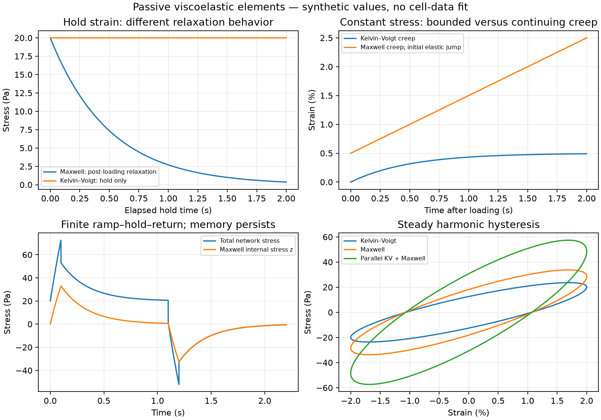

# Chapter 4 — Passive cardiomyocyte mechanics: Maxwell and Kelvin–Voigt

The first target is **passive stretching**, as selected by the author. Active
contraction will be a separate extension. This chapter is a mathematical map
from measurements to element laws, differential equations, energy, and fitting.
It is not a claim that all those topics have already been formalized.

Read the [source audit](../research/002-viscoelastic-source-audit.md) before
copying equations from the cardiomyocyte paper. Use the
[notebook](../../notebooks/passive-viscoelasticity.ipynb) to explore synthetic examples.

## 1. Scientific source

- **Roylance2001**, *Engineering Viscoelasticity*, MIT notes: section 4.1, equation
  (22), gives the Maxwell constitutive law; sections 3–4 and problems 7–10 explain
  creep, relaxation, harmonic response, and spring–dashpot networks. This is a
  mathematical teaching source, originally about materials rather than heart cells.
- **Caporizzo2018**, *Microtubules Provide a Viscoelastic Resistance to Myocyte
  Motion*: Figures 2D and 3B show a Kelvin–Voigt element in parallel with a Maxwell
  element in a cardiomyocyte study. Its displayed equation (4) differs from our
  topology-derived equation. We record that discrepancy rather than silently
  adopting or modifying its formula. No fitted parameters or experimental results
  have been reproduced here.
- **Moulton2017** is a later-scale reading example: Methods / Passive Material
  Properties of Myocardium, equations (19)–(22), uses nonlinear anisotropic elastic
  stress with a viscous contribution. It motivates what a 3D tissue extension would
  need; none of its equations is implemented in this scalar module.

Bibliography and reading scope: [REFERENCES.md](../../REFERENCES.md).
Exact Lean correspondence: [SOURCE_MAP.md](../SOURCE_MAP.md).

## 2. Biological interpretation

A spring represents a reversible response; a dashpot represents rate-dependent
resistance. They are effective mathematical elements, not literal assignments
of every protein to a spring or damper. A whole cell, sarcomere, tissue sample,
and surrounding gel are different systems and cannot share parameters without
an explicit argument. An axial tensile experiment and transverse indentation
also need different measurement-to-model maps.

Our first model is an effective **uniaxial passive material**, near a selected
reference state. Muscle force generation, calcium, cross-bridge cycling, and ATP
supply are absent. A passive spring–dashpot network alone does not generate an
actively driven beat. The existing Hill shortening curve supplies neither this
network topology nor a passive modulus or viscosity.

## 3. Mathematical formulation

### Length, force, strain, and stress

Fix reference length `L₀>0` and area `A₀>0`, and define

$$u=L-L_0,\qquad \varepsilon=\frac{u}{L_0},\qquad \sigma=\frac{F}{A_0}.$$

Here strain is positive for extension and stress is the tensile stress **applied
to the material**. The restoring force on an attached external object has the
opposite direction; mixing these conventions would reverse the power balance.
For a uniform small-strain specimen, `k=EA₀/L₀` and `c=ηA₀/L₀`. A measured
force–displacement stiffness is therefore not a material modulus until geometry
is accounted for. Reference area is held fixed in this engineering-stress model.

### The two element laws

$$\text{Spring: }\sigma_s=E\varepsilon_s,\qquad
\text{dashpot: }\sigma_d=\eta\dot\varepsilon_d.$$

For **Kelvin–Voigt**, the elements are parallel: they share strain, their stresses
add, and

$$\sigma=E\varepsilon+\eta\dot\varepsilon.$$

For **Maxwell**, the elements are in series: the same stress passes through both
and their strains add. With constant positive `E,η`, differentiation gives

$$\dot\varepsilon=\frac{\dot\sigma}{E}+\frac{\sigma}{\eta},
\qquad \dot\sigma=E\left(\dot\varepsilon-\frac{\sigma}{\eta}\right).$$

Adding the words “Maxwell and Kelvin–Voigt” does not specify a model. Connecting
them in series gives a different network from connecting them in parallel.

### A parallel network suggested by the cardiomyocyte paper

Use a Kelvin–Voigt branch `(E₁,η₁)` parallel to a Maxwell branch `(E₂,η₂)`.
Let `z` be the stress in the Maxwell branch. Its topology is:

```text
common top endpoint    ──┬────────┬────────┬──
                        │        │        │
                       η₁       E₁       E₂
                        │        │        │
                        │        │       η₂
                        │        │        │
common bottom endpoint ──┴────────┴────────┴──
```

With a common effective strain,

$$\boxed{\sigma=E_1\varepsilon+\eta_1\dot\varepsilon+z,\qquad
\dot z=E_2\dot\varepsilon-\frac{E_2}{\eta_2}z.}$$

This internal-state form is the clearest starting point. In a strain-controlled
experiment, `ε(t)` is prescribed, so solve one ODE for `z` and compute total
stress. In a stress-controlled experiment, prescribe `σ(t)` and solve

$$\dot\varepsilon=\frac{\sigma-E_1\varepsilon-z}{\eta_1},\qquad
\dot z=E_2\dot\varepsilon-\frac{E_2}{\eta_2}z.$$

The latter needs initial strain and internal stress. The internal state represents
loading history; arbitrarily resetting it erases that history.

If the histories are sufficiently differentiable, eliminate `z` to obtain

$$\eta_1\eta_2\ddot\varepsilon+
(E_1\eta_2+E_2\eta_2+E_2\eta_1)\dot\varepsilon+E_1E_2\varepsilon
=E_2\sigma+\eta_2\dot\sigma.$$

Lean checks the pointwise algebra from supplied rates. It does not yet prove
existence of histories or equivalence of all initial-value formulations.
The coefficient differs from the paper's online equation (4); see the audit.

A standard linear solid is obtained by omitting the parallel dashpot, giving a
spring parallel to a Maxwell branch. The full four-element network above keeps
that extra dashpot. A Burgers network instead places Maxwell and Kelvin–Voigt
branches **in series**. These names do not make the topologies interchangeable.

### Creep, relaxation, and loading jumps

Set `τ=η/E>0` for the basic elements.

| Experiment | Maxwell | Kelvin–Voigt |
|---|---|---|
| Hold strain fixed after loading | `σ(t)=σ(0⁺) exp(-t/τ)` | `σ(t)=E ε₀` during the hold |
| Apply constant stress from rest | `ε(t)=σ₀/E+σ₀ t/η` for t>0 | `ε(t)=(σ₀/E)[1-exp(-t/τ)]` |

A pure Maxwell element permits unbounded creep and loses its held-strain stress;
it has no long-time elastic plateau. A Kelvin–Voigt element has delayed bounded
creep but cannot model decaying stress during a perfectly constant-strain hold.
A restoring parallel spring can provide a nonzero equilibrium plateau.

An ideal step is not an ordinary differentiable input. In Kelvin–Voigt, an ideal
strain jump produces an impulsive dashpot stress. The hold formula omits that
impulse; the notebook uses a finite ramp for the combined network. For Maxwell
relaxation, `stress0` is a supplied **post-loading** value. We have not formalized
Dirac distributions or jump conditions.

### Energy and passivity

Input power per reference volume is `σ ε̇`. A spring stores
`Ψ=E ε²/2`; its derivative is `E ε ε̇`. Kelvin–Voigt therefore satisfies

$$\sigma\dot\varepsilon=\dot\Psi+\eta\dot\varepsilon^2.$$

For the parallel network, choose

$$\Psi=\frac{E_1\varepsilon^2}{2}+\frac{z^2}{2E_2},\qquad
\mathcal D=\eta_1\dot\varepsilon^2+\frac{z^2}{\eta_2}.$$

Its branch equations give `σ ε̇=Ψ̇+𝒟`. With positive elastic moduli and
nonnegative/positive viscosities as stated by each lemma, stored energy and
viscous dissipation are nonnegative. This is a useful consistency check on the
chosen passive equations, not a proof of all biological thermodynamics. A full
integrated work inequality has not yet been formalized.

### Frequency response and hysteresis — derived here, not yet formalized

For harmonic strain, use the convention `ε=Re(ε̂ exp(iωt))` and
`σ=Re(E*(ω) ε̂ exp(iωt))`, with `E*=E′+iE″` and `ω≥0`.
The spring stores energy; the loss modulus describes the dissipative part.
Writing `x=ωη/E`,

$$E^*_{KV}=E+i\omega\eta,\qquad
E^*_{M}=E\frac{ix}{1+ix},\qquad
E'_M=E\frac{x^2}{1+x^2},\quad E''_M=E\frac{x}{1+x^2}.$$

For the parallel network, `E′=E₁+E₂ x₂²/(1+x₂²)` and
`E″=ωη₁+E₂ x₂/(1+x₂²)`, where `x₂=ωη₂/E₂`. In a steady harmonic cycle with
strain amplitude `ε_a`, the work dissipated per reference volume is
`π E″ ε_a²`. These formulas and the notebook's loop-area check are informal
mathematics/numerical checks, not completed Lean theorems.



*The figure uses synthetic parameters. It is a comparison of mathematical element
responses, not experimental cell data or a fit to the cited paper.*

The linear elements are bilateral: they can carry tension or compression.
Negative stress in the return or harmonic examples is not active force generation.
A tension-only cell/specimen, slackening, buckling, or contact constraint needs
an additional law and an appropriate loading/prestrain regime. Such constraints
can make the model nonlinear or nonsmooth; they have not been implemented.

## 4. Assumptions

| Assumption | Consequence / limit |
|---|---|
| Small uniaxial engineering strain | Excludes finite-strain and tensor effects |
| Constant effective parameters and reference geometry | Differentiating E(t)ε would need an additional term; large geometry changes need different measures |
| Quasistatic massless network | Equal series stress / parallel strain are element-network constraints; no cell inertia equation is included |
| Passive regime | No imposed active stress, calcium activation, or ATP-driven mechanics |
| Positive E and η where division or physical interpretation requires them | Negative viscosity can produce energy; zero values can change the equation type |
| Sufficiently smooth histories within each loading phase | Derivatives and energy identities do not automatically hold at ramp corners or jumps |
| Initial internal state supplied | History is part of the model, not determined by current strain alone |
| Effective branches use common reference measures | Actual branches with differing geometry need geometric factors, absorbed into effective parameters here |

The notebook uses synthetic values and does not select parameters for real cells.
The user's confirmed direction is passive-first; the parallel four-element
network remains a literature-motivated candidate, not a fit-selected final topology.

## 5. Physical units

| Quantity | Unit |
|---|---|
| `L₀,u` | m |
| `A₀` | m² |
| `F` | N |
| `σ,z,E` | Pa |
| `ε` | dimensionless |
| `ε̇` | s⁻¹ |
| `η` | Pa·s |
| `τ=η/E` | s |
| `Ψ` | J/m³ = Pa |
| `σ ε̇,𝒟` | W/m³ = Pa/s |

Units are documented, not enforced by the real-number Lean representation.

## 6. Lean implementation

[LinearViscoelastic.lean](../../CardioLean/Mechanics/LinearViscoelastic.lean),
namespace `CardioLean.Mechanics.LinearViscoelastic`, contains spring/dashpot laws,
Kelvin–Voigt stress, Maxwell stress rate, spring energy, parallel-network stress,
Maxwell relaxation, and Kelvin–Voigt creep.

`HasDerivAt` checks a specified derivative at a point. The chain/product rules
supply energy and response derivatives; `ring`, `field_simp`, and `nlinarith`
check rearrangements with explicit denominator conditions. The network
second-order identity uses supplied strain/stress rates; those algebraic inputs
are not a substitute for checking differentiability of actual histories.

## 7. Proof obligations

| Lean theorem | Scope |
|---|---|
| `springEnergy_nonneg`, `springEnergy_hasDerivAt` | Nonnegative stored energy; elastic power as its derivative |
| `dashpot_dissipation_nonneg`, `kelvinVoigt_power_balance` | Dashpot sign and Kelvin–Voigt pointwise power identity |
| `maxwell_rate_iff`, `maxwell_power_balance` | Series-rate rearrangement and power balance for the Maxwell law |
| `parallel_power_balance`, `parallel_dissipation_nonneg` | Parallel network power identity and dissipation sign |
| `parallel_second_order` | Algebraic elimination of internal stress from the stated branch/rate relations |
| `relaxation_initial`, `relaxation_hasDerivAt`, `relaxation_bounds` | Maxwell post-loading initial value, ODE rate, and nonnegative-time bounds |
| `kelvinCreep_initial`, `kelvinCreep_hasDerivAt`, `kelvinCreep_balance` | Kelvin–Voigt creep initial value, derivative, and applied-stress balance |

## 8. Verification status

Definitions: **Formal definition completed**. The 15 theorems listed above:
**Machine-checked proof completed**, with actual commands and environment recorded
in [VERIFICATION.md](../VERIFICATION.md). This does not amount to formalizing the
entire Caporizzo paper or validating a human cardiomyocyte model.

The source discrepancy is an **Under investigation** literature issue, with an
algebraic counterexample checked in [ModelChecks.lean](../../test/ModelChecks.lean).
Full history-solution theory for the parallel network, integrated energy
inequalities, complex-modulus proofs, geometry conversion, and active contraction
remain **Not started** as Lean formalizations. No independent human review or
experimental fit is claimed.

## 9. Mathematics to learn next and model decisions still needed

1. **Calculus and units:** distinguish strain, strain rate, stress, modulus, and
   stiffness; work through the two element laws and their signs.
2. **Linear algebra and ODEs:** internal states, initial conditions, eigenvalues,
   matrix exponentials, existence/uniqueness, and stability. Under stress control,
   the four-element network needs two states; one creep/relaxation time is not
   enough to characterize every experiment.
3. **Energy methods:** derive storage and dissipation, then integrate over a
   cycle; test positive parameters rather than assuming any fitted values are physical.
4. **Transforms and history:** Laplace/Fourier methods, convolution, and generalized
   Maxwell spectra. For a smooth zero-initial-strain history, `σ(t)=∫₀ᵗ G(t-s) ε̇(s) ds`;
   nonzero history, loading jumps, and ideal Kelvin–Voigt viscosity need extra terms
   or distributional formulations. Do not identify creep compliance with the
   reciprocal of the relaxation modulus at each time.
5. **Inverse problems:** design ramp-hold, creep, and frequency sweeps; distinguish
   structural identifiability from noisy parameter estimation. Report strain range,
   direction, temperature, preparation, and preconditioning when data becomes available.
6. **Beyond this approximation:** finite deformation, anisotropy, incompressibility,
   appropriate stress measures and boundary conditions, followed by a separate
   active-stress or active-strain law with activation dynamics and energy supply.

Before fitting a cell model, specify the specimen and direction, loading protocol,
measured force/length or stress/strain, geometry convention, and passive preparation.
Then compare candidate networks against held-out protocols. There is currently
no basis for claiming that the synthetic parameters represent your cardiomyocytes.
