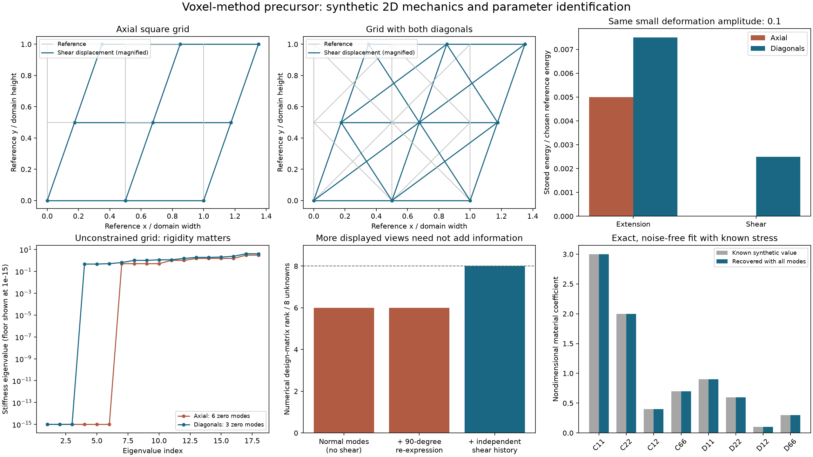

# Chapter 5 — Exploring MRI-informed pixel and voxel mechanics

Date: 2026-11-06. This chapter records an exploratory **passive, small-deformation
2D precursor** to a possible voxel method. It is not an MRI reconstruction
pipeline, a fitted myocardial material, or a completed 3D model.

Start with the [executed notebook](../../notebooks/voxel-method.ipynb), then use
the [literature and decision guide](../research/003-voxel-method-literature.md).
The author can review this work later and choose which modeling assumptions to
keep. Synthetic examples are labeled throughout. Python also includes a small
3D connectivity check; this is not a 3D constitutive or MRI implementation.

## First results to review

| Question | Observed result | Scope |
| --- | --- | --- |
| Does a square axial grid resist small shear? | No; adding diagonals removes that particular mechanism in the tested patches | Numerical 2D/3D checks; planar shear limitation also proved in Lean |
| Does a 90-degree re-expression identify missing parameters? | No: rank remains 6 out of 8 | Same synthetic stress equations, same parameter vector |
| Can additional deformation histories identify all eight? | Rank 8, noise-free recovery error below 7e-15 | Chosen tensor law with known synthetic stress/strain/rate |
| Can a genuinely new observed component help? | Idealized displacement-observation rank increases from 2 to 3 | Separate projector example, not a material-parameter fit |
| Is this an MRI tissue reconstruction? | Not started | No real images, loading data or physiological fit |

A zero mode is a motion that produces no first-order spring energy. For the
3-by-3 planar node grid, unconstrained axial/diagonal nullities were 6/3; after
removing three rigid-motion freedoms, they were 3/0. For a 3-by-3-by-3 node cube,
six-neighbor/diagonal nullities were 27/6; after removing six rigid-motion
freedoms, they were 21/0. These are the specific tested regular graphs, not a
rigidity theorem for arbitrary segmented tissue.

The 3D test uses positive unit link weights only to inspect topology. Its
diagonals do not constitute a calibrated 3D material. The 2D affine refinement
check uses different explicit toy weights to keep two selected uniform-strain
energies constant across four grid resolutions; it is not a convergence study.

## 1. Scientific source

| Reference | Inspected location and role | Adoption boundary |
| --- | --- | --- |
| Roylance2001 | Section 4.1, equation (22); existing scalar Maxwell law | Standard element mathematics, reused with force/extension units |
| Mao2010 | Original abstract on the author-preprint record | Motivates checking shear mechanisms of an axial square grid |
| Asner2016 | Sections 2.2 and 2.4 | MRI geometry, displacement, loading and reference-state requirements; not a source for the proposed network |
| Hadjicharalambous2015 | Section 2.3.1, equations (13)–(14), Theorem 2 | Identifiability depends on independent constraints under stated assumptions |
| Castelein2025 | Acquisition and Data Processing / Image Analysis | Wave-derived mechanical surrogates; not a conversion from MRI intensity to edge coefficients |
| Parvizian2007 | Bibliographic record and original abstract only | Embedded-grid continuum alternative to investigate; full equations not adopted |

See [REFERENCES.md](../../REFERENCES.md) for verified bibliographic information
and [SOURCE_MAP.md](../SOURCE_MAP.md) for actual Lean declarations.

The finite graph, its energy calculation, its explicit shear example, and the
eight-parameter synthetic experiment are **project derivations or modeling
choices**. No paper is credited with providing those exact implementations.
The unresolved Caporizzo2018 coefficient issue in the
[source audit](../research/002-viscoelastic-source-audit.md) is not resolved or
silently incorporated by this work.

## 2. Biological interpretation

A material pixel represents an effective tissue region. It is not automatically
one cardiomyocyte. A voxel is a 3D volume; the implemented experiment is planar.

MRI-derived anatomy could eventually supply the tissue mask, physical spacing,
orientation, and boundary shape. Motion-sensitive acquisitions could supply
kinematic observations. Mechanical properties require a forward model, loading
information or additional mechanical constraints, and an inverse calculation.
Conventional image brightness is not a measured spring stiffness.

There are two different model families in this exploration:

1. **Axial network:** nodes have planar displacement, and unique connections
   transmit scalar tensile/compressive forces along fixed reference directions.
   This is the family represented by the new Lean mathematics.
2. **Orthotropic continuum example:** each material region has coupled normal
   and shear stresses. A simple eight-coefficient Kelvin–Voigt law is used only
   in Python identification experiments. It is not yet a Lean constitutive law.

Four sides times stiffness/viscosity gives eight coefficients in a local
connection sketch. Four elastic plus four viscous tensor coefficients is a
different eight-parameter construction. Neither count follows from viewing an
MRI volume from two angles. Shared connections must be counted once globally.

The first target remains passive stretching. Active tension, calcium,
cross-bridge kinetics, and the beating-heart loading problem remain separate.

## 3. Mathematical formulation

### Reference geometry and compatibility

For an oriented link e=(i,j), let X_i be a reference node position and u_i its
displacement. For distinct reference positions, the intended geometric direction is

$$L_e=\|X_j-X_i\|>0,\qquad n_e=(X_j-X_i)/L_e.$$

The small-deformation axial extension and extension rate are

$$q_e=n_e\cdot(u_j-u_i),\qquad
\dot q_e=n_e\cdot(v_j-v_i).$$

The Lean core accepts directions as supplied data. Its algebraic identities do
not automatically certify their normalization or their origin from an image.
Geometry preparation must enforce those physical conditions.

A positive tensile F_e acts as +F_e n_e on endpoint i and -F_e n_e on endpoint j.
Each physical connection is stored once. Reversing both endpoints and direction
preserves extension and the physical endpoint forces.

### A passive connection with memory

Use an equilibrium spring and dashpot in parallel with one Maxwell branch:

$$F_e=k_{0e}q_e+c_{0e}\dot q_e+z_e,\qquad
\dot z_e=k_{1e}\left(\dot q_e-\frac{z_e}{c_{1e}}\right).$$

Here z_e is internal **force**, not stress. Define

$$W_e=\frac{k_{0e}q_e^2}{2}+\frac{z_e^2}{2k_{1e}},\qquad
D_e=c_{0e}\dot q_e^2+\frac{z_e^2}{c_{1e}}.$$

For constant coefficients, nonnegative k_0,c_0 and positive k_1,c_1,
differentiable trajectories satisfying
the branch equation obey

$$F_e\dot q_e=\dot W_e+D_e,\qquad W_e\ge0,\quad D_e\ge0$$

Summing over a finite set of links gives the
corresponding total storage/dissipation identity.

For nodal dynamics with a constant symmetric mass matrix M, the intended assembly is

$$q=Bu,\qquad M\ddot u+B^\mathsf{T}F=f_{\mathrm{ext}},$$

and the intended full mechanical energy statement is

$$\frac{d}{dt}\left(\tfrac12\dot u^\mathsf{T}M\dot u+\sum_eW_e\right)
=f_{\mathrm{ext}}\cdot\dot u-\sum_eD_e.$$

Nonnegative kinetic energy additionally requires M positive semidefinite.
External power must include reaction-force work at prescribed moving boundaries,
or those boundary-work terms must be displayed separately.

Keep the actual checked edge/assembly identities separate from this full
initial-boundary-value problem: mass, imposed boundary work, solution existence,
uniqueness, and numerical time stepping are additional obligations.

### Why shear is a required failure test

For a square nearest-neighbor axial grid, take

$$u(x,y)=(\gamma y,0).$$

Every horizontal and vertical axial extension is zero, even though the
displacement is not a rigid translation or rotation when gamma is nonzero.
The same is true of axial rates for a time-varying gamma. Initial Maxwell states
must also be zero to infer zero complete internal force from this observation.

Thus positive connection coefficients alone do not make a square axial grid a
material with shear stiffness. Diagonal connections can remove this particular
mechanism; they do not establish arbitrary constitutive behavior, rigidity of
every segmented mask, or convergence to myocardium.

A continuum alternative uses

$$\varepsilon(u)=\tfrac12(\nabla u+\nabla u^\mathsf{T}).$$

That tensor includes both normal stretching and shear. No continuum finite
element implementation is claimed here.

### An illustrative eight-parameter material

Choose known planar material axes, linear response, orthotropic symmetry and
reciprocal elastic/viscous coupling. Using engineering shear strain, set

$$e=(\varepsilon_{xx},\varepsilon_{yy},2\varepsilon_{xy})^\mathsf{T},
\qquad s=(\sigma_{xx},\sigma_{yy},\sigma_{xy})^\mathsf{T},$$

$$s=C e+D\dot e,\quad
C=\begin{pmatrix}C_{11}&C_{12}&0\\C_{12}&C_{22}&0\\0&0&C_{66}\end{pmatrix},
\quad
D=\begin{pmatrix}D_{11}&D_{12}&0\\D_{12}&D_{22}&0\\0&0&D_{66}\end{pmatrix}.$$

There are four independent entries in each matrix. Positive-definite synthetic
C and D give positive elastic energy and viscous dissipation for nonzero
strain/rate. This is a chosen learning example, not an experimentally established
myocardial law. Unknown fiber angles, nonlinear deformation, or additional
relaxation branches would introduce further unknowns.

### Observations, rotations, and inverse fitting

For known synthetic strain/rate/stress samples, the eight-coefficient law yields

$$A\theta=y.$$

More than eight rows makes this linear problem overdetermined. Unique
least-squares identification additionally requires rank(A)=8. A small singular
value indicates noise sensitivity even when the computed rank is full.

Re-expressing existing complete observations in rotated coordinates cannot add
independent information: the new equations are invertible combinations of the
old equations. A genuinely additional measured component can add information.
Neither change creates a new loading history.

If all strains and rates have zero shear, C_66 and D_66 are unobservable in this
synthetic experiment. Independent shear and time-dependent normal/shear histories
can provide missing constraints.

For a single Kelvin–Voigt connection, if dot(q)=lambda*q throughout acquisition,

$$F=(k+\lambda c)q.$$

Only that combination is identified, even with many frames. Appropriate different
strain/rate histories and sufficient force information can separate the two.

The MRI problem would instead compare measured motion with a solved model:

$$\min_{\theta}\|H u_\theta-d_{\mathrm{MRI}}\|_W^2+\alpha R(\theta).$$

H includes the measured components, sampling, registration and image-plane
projection. The known-stress synthetic experiment is not this full inverse
problem. For nonlinear forward models, a sensitivity-rank check is local and
does not prove global uniqueness.

## 4. Assumptions

| Assumption | Kind | Reason / status |
| --- | --- | --- |
| Small displacements/rotations about a fixed reference | Mathematical/modeling | Fixed axial directions and linearized strain; finite rotation objectivity is not established |
| Unique links, shared endpoint displacements | Discretization | Avoid duplicate interface forces and inconsistent neighboring motions |
| Nonnegative equilibrium stiffness/parallel viscosity; positive Maxwell stiffness/viscosity | Mathematical | Nonnegative storage/dissipation and meaningful branch divisions |
| Constant coefficients | Modeling | No remodeling, damage or temperature dependence |
| Passive bilateral response | Modeling | Compression is permitted; no slack, buckling, contact or activation |
| Chosen thickness and 2D reduction | Modeling | Needed to interpret a slice as a mechanical material |
| Known material axes in the tensor example | Modeling | Axis estimation is not included |
| Known synthetic stresses/strains/rates in the linear fit | Experimental setup | These are generated data, not information assumed available from ordinary MRI |
| Planar image motion represents the intended material motion | Unestablished for real data | Through-plane motion requires separate treatment |
| Independent initial memory states and boundary conditions specified | Mathematical | Needed for a history-dependent forward problem |

A heart imaged in diastole is not automatically stress-free or completely
inactive. Those are questions for a specific dataset and physiological setting.

## 5. Physical units

| Quantity | Intended dimensional convention |
| --- | --- |
| Reference position, u, q | m |
| Velocity, extension rate | m/s |
| F, z, external nodal force | N |
| k_0, k_1 | N/m |
| c_0, c_1 | N s/m |
| W | J |
| D, force times extension rate | W |
| Continuum strain e | Dimensionless |
| Continuum stress s and elastic C | Pa |
| Continuum viscosity D matrix | Pa s |

For a uniform axial specimen, k=EA/L and c=eta*A/L. Area includes effective slice
thickness when interpreting a planar material. These conversions do not uniquely
calibrate a diagonal lattice to an arbitrary tensor law.
The experiment uses explicitly normalized synthetic numbers; it does not assign
human cardiac values. Lean real-number types do not enforce dimensions.

## 6. Lean implementation

The new [PlanarNetwork.lean](../../CardioLean/Mechanics/PlanarNetwork.lean) extends
the existing [LinearViscoelastic.lean](../../CardioLean/Mechanics/LinearViscoelastic.lean).
Read its comments for the precise hypotheses and proof strategies.

There are 21 named checked theorems in this module. Its strongest energy result
is an actual derivative of total stored energy, conditional on supplied
differentiable nodal trajectories and internal states obeying the Maxwell law.
It identifies that derivative with minus internal nodal power minus dissipation;
it does not solve a nodal equation or prove the external-work/kinetic identity.

Real pairs keep the planar vector calculations explicit. A finite edge index
allows energy identities to be summed without introducing continuum machinery.
The ring tactic verifies polynomial rearrangements; field_simp clears the
declared nonzero stiffness denominators. HasDerivAt records a derivative at a
specific time; differentiating a finite sum does not prove that a mechanical
trajectory exists. The shear proof evaluates an alleged rigid motion at three
corners to show that nonzero shear cannot be a translation plus infinitesimal
rotation.

The checked declaration index is maintained in [SOURCE_MAP.md](../SOURCE_MAP.md).
The eight-coefficient tensor law, least-squares fitting and singular-value
calculations are Python experiments, not extracted Lean code.

## 7. Proof obligations

| Target | Scope |
| --- | --- |
| Endpoint reversal and rigid translation | Axial compatibility should be unaffected |
| Equal/opposite forces and endpoint power | Each link should preserve force balance and the work sign convention |
| Nonnegative connection storage and dissipation | Conditional on coefficient signs |
| Edge and finite-sum power identities | Separate algebraic rate identities from actual time derivatives |
| Square-grid shear counterexample | Demonstrates a missing material behavior rather than a successful tissue model |
| Kelvin–Voigt parameter ambiguity | Distinct parameters may give the same response under restricted histories |
| Rigidity/coercivity with selected boundaries | Further work; nonnegative energy alone is insufficient |
| Forward solution existence and uniqueness | Further work for the selected discretization and constraints |
| Stable time stepping and mesh convergence | Further work; a few finite-grid experiments do not prove convergence |
| MRI observation model and parameter identifiability | Further work beyond the known-stress synthetic example |

## 8. Verification status

Actual commands, accepted declarations and numerical results are recorded in
[VERIFICATION.md](../VERIFICATION.md). Formal definitions and checked theorems
are indexed per item in [SOURCE_MAP.md](../SOURCE_MAP.md).

| Item | Category | Evidence boundary |
| --- | --- | --- |
| Planar-network definitions | Formal definition completed | Representation details and declaration names in SOURCE_MAP |
| Twenty-one planar-network theorems | Machine-checked proof completed | Lean checks only their stated formulas and hypotheses |
| Numerical 3D connectivity checks | Under investigation | Regular test graphs only, no 3D tissue constitutive law |
| Synthetic grids and eight-parameter fits | Under investigation | Executed numerical exploration, not a formal theorem |
| MRI import, registration and inverse fitting | Not started | No real images supplied or fitted |
| 3D voxel continuum mechanics | Not started | Python checks only 3D connection geometry; Lean and tensor identification are planar |
| Physiological suitability | Under investigation | No experimental comparison performed |
| Independent human review | Not started | No independent review is claimed |

Experimental-evidence record: this repository generates synthetic examples.
It does not reproduce the datasets or experimental findings of the cited papers.
MRE frequencies and wave-derived surrogates cannot be silently treated as
slow-stretch spring/dashpot coefficients.

## 9. Limitations, decision points, and next work

Recommended first comparison: extension, shear, translation, infinitesimal
rotation, relaxation, energy accounting, and parameter recovery on a small patch.
Then choose an explicit material family before implementing MRI data handling.

For MRI-informed tissue properties, a pixel/voxel-labeled continuum mesh is a
promising direction to investigate. Image resolution and mechanical mesh
resolution need not be identical. An axial lattice remains useful for learning,
but its effective shear response, directional bias and refinement behavior need
their own calibration.

The author can review these choices later:

1. Is the first object a tissue patch, a whole ventricular slice, or a 3D region?
2. Which MRI sequences and loading information are available?
3. Is the goal predicting deformation or identifying material parameters?
4. Should the initial material be isotropic, orthotropic with known axes, or
   include measured/estimated fiber directions?
5. Which omissions matter first: finite deformation, near incompressibility,
   out-of-plane motion, residual stress, or activation?

Do not increase parameter count merely because more image samples exist. First
test recovery of known parameters with synthetic noise and held-out loading
histories. Refine the spatial grid independently and assess whether predictions
change for mechanical rather than purely numerical reasons.
