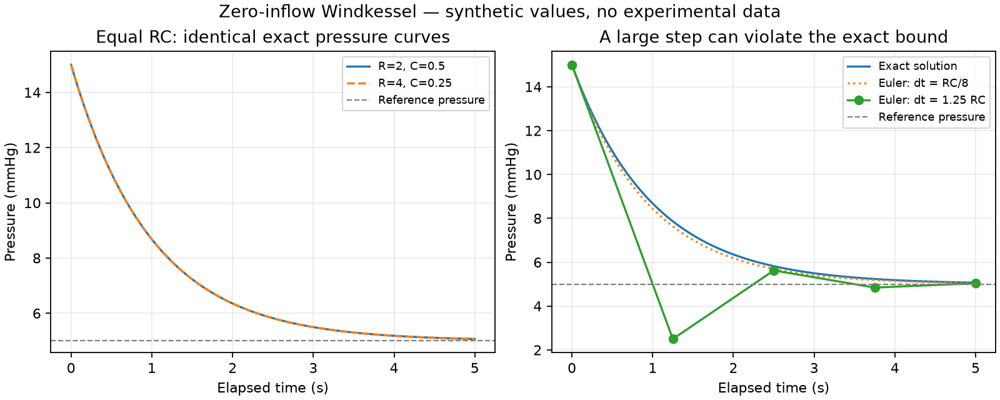

# Chapter 2 — A first dynamic component: the two-element Windkessel

This chapter introduces a function of time and checks that its derivative obeys
a specified flow balance. Start with [the research choices](../research/001-next-directions.md)
and use [the notebook](../../notebooks/windkessel-exploration.ipynb) for numerical exploration.

## 1. Scientific source

**Direct sources:** [Wang2003](../../REFERENCES.md), Methods → Theory → Windkessel
theory, printed **H1359**, equations **(1)–(3)** (PDF page 2); and
[Alastruey2010](../../REFERENCES.md), Methodology → Reservoir-Excess Separation,
equations **(1)–(2)**. Both original research articles were consulted, with
bibliographic metadata checked against Crossref on 2026-11-05.

Wang uses `P_Wk`, `P_∞`, `R`, and `C`; Alastruey uses `p_w`, `P_out`, `R_T`, and
`C_T`. Our names are `pressure`, `pOut`, `R`, and `C`. We select **zero inflow**
and set the initial time to zero. The source's general-input solution, wave
model, experiments, and parameter-fitting methods are not implemented.
See [SOURCE_MAP.md](../SOURCE_MAP.md) for declaration-by-declaration attribution.

## 2. Biological interpretation

The arterial system is represented here by one pressure state, a compliance,
and a resistive outflow. Compliance relates pressure changes to stored volume
changes; resistance relates a pressure difference to outflow. For this selected
zero-inflow interval, pressure can fall while fluid leaves the compartment.
These are modeling assumptions, not a reconstruction of individual vessels.

`pOut` is a fixed reference for outflow. It is not silently assumed to equal
zero or measured venous pressure. The curve is an arterial component, not
ventricular pressure, muscle force, or a complete heartbeat. It has no valve
state, geometry, activation, wave propagation, or feedback control.

## 3. Mathematical formulation

The balance adapted from Alastruey's equation (1) is

$$q_{in}(t)=C p'(t)+\frac{p(t)-p_{out}}{R}.$$

For `q_in(t)=0`, constant `R>0`, `C>0`, and fixed `p_out`, choose

$$p(t)=p_{out}+(p_{init}-p_{out})\exp\!\left(-\frac{t}{RC}\right).$$

This is the zero-input, zero-initial-time specialization of the source solution.
To understand the construction, put `x(t)=p(t)-p_out`. The equation becomes
`x'(t)=-x(t)/(RC)`. An exponential has a derivative proportional to itself,
so try `x(t)=x(0) exp(-t/(RC))`. Substitution verifies the candidate without
having to divide by `x(t)`; the equilibrium case `p_init=p_out` is included.

Two checks are needed: `p(0)=p_init`, and the derivative satisfies the balance.
Matching the initial value alone would not make a function a solution.

## 4. Assumptions

| Assumption | Role and origin |
|---|---|
| A single compartment and linear outflow law | Selected lumped model, not detailed vessel mechanics |
| Constant `R`, `C`, and `pOut` | Fixed-parameter regime used in the source equations |
| `R>0`, `C>0` | Chosen admissible regime; permits cancellation and gives a positive time constant |
| Inflow identically zero | Explicit specialization, not a general cardiac output waveform |
| `pInit ≥ pOut` | Ensures a nonnegative initial pressure difference and outward resistive flow |
| `t≥0` | Elapsed-time interpretation and the upper bound by initial pressure |
| Compatible fixed units | Required interpretation of the real-number values |

The Lean function has a smooth extension to all real times. Its derivative and
initial-value identities do not need sign assumptions. The balance theorem
requires positive `R,C`; the lower bound needs only `pInit≥pOut`; the upper
bound also needs positive `R,C` and `t≥0`. Nonincrease holds on the full smooth
extension for positive `R,C` and `pInit≥pOut`. These mathematical statements do
not imply a physical interpretation at negative elapsed time.

## 5. Physical units

| Quantity | Meaning | Example unit |
|---|---|---|
| `t` | Elapsed time | s |
| `p`, `pOut`, `pInit` | Pressure and reference/initial pressure | mmHg |
| `q_in`, `outflow` | Volume flow rate | mL/s |
| `R` | Resistance | mmHg·s/mL |
| `C` | Compliance | mL/mmHg |
| `R*C` | Time constant | s |
| `p'` | Pressure rate | mmHg/s |

The exponential argument `-t/(R*C)` is dimensionless. Both terms on the right
of the balance have flow units. Lean's real-number types do not enforce units.
Pressure bounds are relative to `pOut`; absolute nonnegative pressure would
additionally require a nonnegative reference.

## 6. Lean implementation

Module: [Windkessel.lean](../../CardioLean/Circulation/Windkessel.lean).
Namespace: `CardioLean.Circulation.Windkessel`.

- `outflow R pOut pressure` defines `(pressure-pOut)/R`.
- `SatisfiesBalanceAt R C pOut inflow pressure t` asks for a real rate together
  with `HasDerivAt pressure rate t` and the actual flow-balance equality.
- `decay R C pOut pInit t` defines the exponential candidate above.

`HasDerivAt` means the function has the stated derivative at that time. An
explicit witness avoids treating the default value of Lean's `deriv` at a
nondifferentiable point as a physical rate. Division is total in Lean; positive
physical parameters remain necessary even though formulas can elaborate at zero.

The derivative proof applies the chain rule (`.exp`) to a scaled time function,
then multiplies and adds constants. `convert` aligns the expression with the
stated derivative; `ring` checks algebraic rearrangement. The balance proof
substitutes that derivative, and `field_simp` cancels nonzero denominators.
For the bounds, `Real.exp_pos` gives a positive exponential and
`Real.exp_le_one_iff` connects an exponent at most zero to a factor at most one.
Nonincrease compares exponents at two ordered times; calculus is not needed
for that comparison after the function has been defined.

## 7. Proof obligations

All names below are relative to `CardioLean.Circulation.Windkessel`.

| Theorem | Exact scope |
|---|---|
| `decay_initial` | Initial value, all real parameters |
| `decay_hasDerivAt` | Derivative of the total real function, all real parameters and times |
| `decay_satisfies_zeroInflow` | Flow balance at every real time, if `R>0`, `C>0` |
| `decay_ge_out` | `pOut ≤ p(t)` if `pOut ≤ pInit` |
| `decay_le_initial` | `p(t) ≤ pInit` if `R>0`, `C>0`, `pOut ≤ pInit`, `t≥0` |
| `decay_antitone` | Nonincrease for positive `R,C` and `pOut ≤ pInit` |
| `outflow_nonneg` | Nonnegative outflow when `R>0` and `pressure≥pOut` |
| `decay_at_timeConstant` | For positive `R,C`, `p(RC)=pOut+(pInit-pOut) exp(-1)` |
| `decay_eq_of_product_eq` | Equal `R*C` products give equal functions for the same `pOut,pInit` |

The last theorem is a project derivation. It exposes an important limitation:
this pressure curve alone cannot distinguish different positive pairs of `R,C`
with the same product. It does not establish indistinguishability when outflow
or a different forced-flow experiment is observed.

## 8. Verification status

The definitions are **Formal definition completed**. All nine theorems above
are **Machine-checked proof completed** on Proxmox with the pinned toolchain;
see [the verification record](../VERIFICATION.md) for commands and evidence.
No independent human review is claimed. [Chapter 3](WindkesselConstant.md) now
adds constant input and interval-local conditional uniqueness, including uniqueness
for arbitrary common input if two differentiable solutions already exist.
General-input existence, a formal limit theorem at infinite time, and
numerical-method guarantees remain **Not started**.

[ModelChecks.lean](../../test/ModelChecks.lean) exercises the public API and
excluded cases. It checks that zero compliance can make the balance impossible,
and that negative compliance can produce pressure growth. The notebook separately
checks finite samples and demonstrates a numerical approximation that crosses
below the reference when its time step is too large. Those observations do not
prove a numerical solver correct.

**Experimental evidence:** source equations and modeling discussion were read;
CardioLean has not fitted or reproduced experimental measurements. Synthetic
notebook values are selected for arithmetic convenience.

## 9. Limitations and next questions

The figure compares equal-RC curves and a forward-Euler approximation, using
synthetic values. After one time constant it is the pressure **difference above
the reference**, not total pressure, that is multiplied by `exp(-1)`.

The next chapter completes the proposed constant-input and conditional uniqueness
steps. Arbitrary waveforms need additional regularity
and solution theory. Pressure-dependent compliance, valve switching, chamber
volume, and coupling to contraction each need their own definitions and sources.
A proof of this component does not establish physiological accuracy or predict
an individual's circulation.
