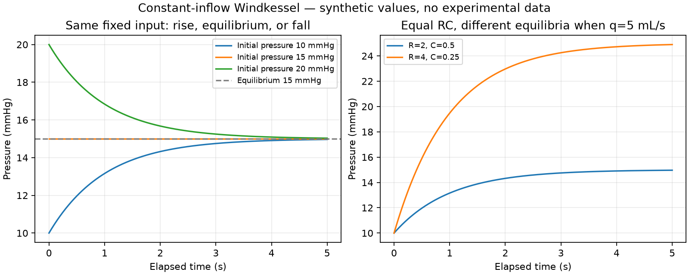

# Chapter 3 — Constant inflow and why the solution is unique

[Chapter 2](Windkessel.md) checked one zero-inflow curve. Here we add a constant
input and a uniqueness argument. A [notebook](../../notebooks/windkessel-constant-inflow.ipynb)
illustrates rising, falling, and equilibrium curves with synthetic values.

## 1. Scientific source

The balance and general solution are from [Wang2003](../../REFERENCES.md),
p. H1359, Methods / Theory / Windkessel theory, equations (1)–(3), and
[Alastruey2010](../../REFERENCES.md), Methodology / Reservoir-Excess Separation,
equations (1)–(2). The latter's balance and general solution were inspected again
on 2026-11-05. **Constant inflow is our explicit specialization** of those source
equations. The equilibrium substitution, bounds, monotonicity, and uniqueness
arguments are project derivations, not claims that the papers contain these Lean proofs.

Notation follows Chapter 2: `pOut` represents the fixed outflow reference,
`R,C` the constant resistance and compliance, and `q` the selected constant
inflow. No new scientific parameter values are taken from either paper.
See [SOURCE_MAP.md](../SOURCE_MAP.md) for exact declarations and source locators.

## 2. Biological interpretation

The component receives a fixed volume flow and discharges through a resistance.
Pressure rises or falls depending on the difference between inflow and outflow.
A fixed input is an elementary test regime, not a pulsatile cardiac ejection
waveform. The model still omits chamber geometry, valves, wave propagation,
activation, and contraction-to-flow coupling.

## 3. Mathematical formulation

The same source equation now has `q_in(t)=q`:

$$q=C p'(t)+\frac{p(t)-p_{out}}{R}.$$

At equilibrium, set the pressure derivative to zero. Solving for pressure gives

$$p_*=p_{out}+Rq.$$

Subtracting this fixed pressure reduces the equation to the previous homogeneous
one. Therefore propose

$$p(t)=p_*+(p_{init}-p_*)\exp\!\left(-\frac{t}{RC}\right).$$

Lean checks both the initial value and the original flow balance. With `q=0`,
this function is exactly the earlier `decay` function. For nonnegative time,
pressure lies between `p_init` and `p_*`. It is nondecreasing when initially
below equilibrium and nonincreasing when initially above it.

### Existence is different from uniqueness

Checking this explicit function gives a solution for the constant-input problem.
Uniqueness asks whether another differentiable solution with the same parameters,
input, and initial value can give a different answer.

Let `d=p−g` for two such solutions. Their common inflow cancels, giving
`d'=-d/(RC)`. Multiplying by an integrating factor gives

$$w(s)=d(s)e^{s/(RC)},\qquad w'(s)=0.$$

The mean-value theorem makes `w` constant on the observed interval. Equal initial
pressures make that constant zero. Since the exponential is strictly positive,
`d=0`, hence `p=g`. No division by the pressure difference is needed, so the
identical-solution and equilibrium cases are covered.

This argument also proves **conditional** uniqueness for a nonconstant input:
if two sufficiently differentiable solutions of the same balance exist, they
agree. It does not construct a solution for every input function.

## 4. Assumptions

| Assumption | Scope and purpose |
|---|---|
| Constant `R>0`, `C>0`, and `pOut` | Same admissible model regime as Chapter 2; cancellation and a positive time constant |
| Constant input `q` | Closed form `constantPressure`; not needed for the general conditional uniqueness theorem |
| `t≥0` | Bounds between the initial and equilibrium pressures, and the uniqueness observation interval `[0,t]` |
| Initial pressure below/above equilibrium | Respective nondecrease/nonincrease theorem |
| Both candidates satisfy the same balance at every point of `[0,t]` | Hypothesis of conditional uniqueness, not an assumed existence theorem |
| Ordinary derivatives at all those points, including endpoints | Explicit regularity required by `SatisfiesBalanceAt`; stronger than one-sided endpoint conditions |
| Equal initial pressure | Required for uniqueness; different initial values need not give the same curve |
| Compatible units | Interpretation convention; not enforced in Lean types |

The algebra and interval bounds allow signed `q`. A regime describing only
forward inflow would additionally select `q≥0`. For pressure to stay above the
outflow reference, select `pInit≥pOut` and `q≥0` as well as positive resistance.
That biological regime is distinct from the weakest hypotheses of each theorem.
No measured venous-pressure interpretation of `pOut` is assumed.

## 5. Physical units

The units are the same as in Chapter 2: pressure in mmHg, flow in mL/s, time in s,
resistance in mmHg·s/mL, and compliance in mL/mmHg. Thus `R*q` is a pressure,
`R*C` is a time, and both exponential arguments `±s/(R*C)` are dimensionless.
All numeric values in the notebook are synthetic arithmetic examples.

## 6. Lean implementation

Module: [WindkesselConstant.lean](../../CardioLean/Circulation/WindkesselConstant.lean),
extending namespace `CardioLean.Circulation.Windkessel`.

- `equilibriumPressure R pOut q` is `pOut + R*q`.
- `constantPressure R C pOut q pInit` reuses `decay` with that equilibrium as its reference.

The proof of the balance substitutes the already checked derivative and cancels
denominators. The bound proof considers whether the initial pressure is below
or above equilibrium and uses the exponential factor between zero and one.

For uniqueness, `obtain` opens the two derivative witnesses supplied by the
balance hypotheses. Subtracting their equations eliminates the common input.
The product and exponential chain rules differentiate `w`. `congrArg` multiplies
the rate equality by the integrating factor, and polynomial tactics verify
cancellation. Mathlib's `constant_of_has_deriv_right_zero` applies the mean-value
argument on the closed interval, using continuity derived from the supplied
ordinary derivatives. Finally `Real.exp_ne_zero` permits concluding that the
pressure difference itself is zero. This is an exact proof, not a comparison of samples.

## 7. Proof obligations

Names below are relative to `CardioLean.Circulation.Windkessel`.

| Theorem | Checked statement and hypotheses |
|---|---|
| `constantPressure_initial` | Initial-value identity for all real parameters |
| `constantPressure_zero` | Zero-input specialization equals `decay`, as functions |
| `outflow_at_equilibrium` | Outflow at `pOut+R*q` equals `q`, if `R>0` |
| `constantPressure_satisfies_balance` | The explicit curve satisfies constant-input balance at every time, if `R,C>0` |
| `constantPressure_bounds` | For `R,C>0`, `t≥0`, pressure lies between `min(pInit,p_*)` and `max(pInit,p_*)` |
| `constantPressure_antitone` | Nonincrease for `R,C>0`, `p_*≤pInit` |
| `constantPressure_monotone` | Nondecrease for `R,C>0`, `pInit≤p_*` |
| `solutions_unique` | For `R,C>0`, `t≥0`, two candidates satisfying the same input balance on `[0,t]` with the same initial value agree at `t` |
| `constantPressure_unique` | Under the same interval regularity and initial-value hypotheses, any constant-input solution agrees with the explicit curve at `t` |

## 8. Verification status

The two definitions are **Formal definition completed**. All nine theorems above
are **Machine-checked proof completed**, with exact commands and environment in
[the verification record](../VERIFICATION.md). The
[API examples](../../test/ModelChecks.lean) exercise nonzero input, interval-local
uniqueness, the rising-case bounds, and the zero-input specialization.

General-input existence, one-sided endpoint formulations, discontinuous-input
switching, infinite-time limit theorems, numerical-method guarantees, and
independent human review remain uncompleted. No experimental fit or physiological
validation was performed.

## 9. Limitations and further questions

Uniqueness of a trajectory with **fixed parameters** does not identify those
parameters from observations. The earlier equal-RC pressure ambiguity applied
to zero inflow. With the same known nonzero inflow and reference pressure,
changing resistance also changes equilibrium: the notebook's particular equal-RC
pair no longer produces identical curves. This numerical example does not
prove general parameter identifiability.

The next coupling step needs a sourced chamber-volume balance and a valve law,
plus explicit conditions at a switching time. Ordinary derivatives on a closed
interval do not automatically accommodate a jump in inflow. Those interfaces,
geometry linking shortening to flow, parameter estimation, and biological
accuracy remain separate tasks.
