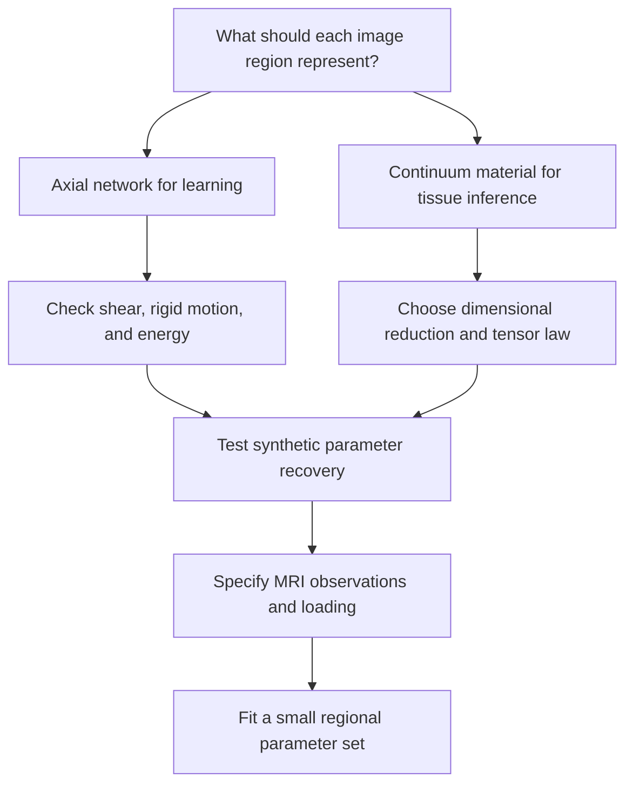

# Research guide: MRI-informed pixels, voxels, and passive mechanics

Date: 2026-11-06. **Research status: Under investigation.**

The proposal is to represent tissue on an image-derived grid and attach passive
Maxwell or Kelvin–Voigt behavior to its mechanical degrees of freedom. The first
implementation target is a **2D precursor**, not a complete 3D voxel heart model.
This guide records source evidence and choices that still need the author's
feedback. It does not report patient-data fitting or physiological validation.

Read [the voxel exploration chapter](../models/VoxelMechanics.md) for the prototype,
then [the scalar passive chapter](../models/PassiveViscoelasticity.md) for its element laws.
Use [the source map](../SOURCE_MAP.md) and [verification record](../VERIFICATION.md)
for the exact implementation and machine-check status. The literature below is
not a claim that the cited authors used CardioLean's proposed network.

## Three possible meanings of a voxel method

| Path | What the image supplies | What the mechanics must supply | Main question |
| --- | --- | --- | --- |
| Axial spring–dashpot lattice | A material mask and reference node positions | Unique links, force balance, internal states, shear-resisting connectivity | Does this particular network represent the material behavior we want? |
| Pixel/voxel continuum discretization | Geometry and spatial material labels | A tensor constitutive law and a consistent finite-element or other discretization | How are shear, directional response, boundaries, and refinement handled? |
| MRI-informed ventricular continuum model | Geometry and measured motion, with uncertainty | A 3D material law, loading, reference state, boundary conditions, and parameter estimation | Which properties can this dataset actually identify? |

The second path keeps the image-grid idea while allowing each material region to
carry a stress/strain tensor. A voxel does not have to be replaced by independent
springs on its faces. The first path remains useful for learning force assembly
and energy accounting. Choosing it is an additional constitutive assumption.

A 2D slice also requires an explicit reduction: plane stress, plane strain,
membrane behavior with thickness, or another justified model. Neither a slice
nor a second perpendicular slice establishes those assumptions automatically.

## Source evidence and reading order

The following five original papers were checked on 2026-11-06. Evidence depth is
recorded separately from metadata. Entries with abstract-only access are reading
candidates, not sources for an adopted equation.

### 1. Why a square axial grid can fail

**[Mao2010]** Mao, X., Xu, N., and Lubensky, T. C. (2010).
*Soft Modes and Elasticity of Nearly Isostatic Lattices: Randomness and Dissipation*.
Physical Review Letters, **104**, 085504.
[DOI](https://doi.org/10.1103/PhysRevLett.104.085504).
[Author preprint and publication record](https://arxiv.org/abs/0909.2616).

**Locator and evidence:** original abstract on the author-preprint record,
including the published journal identifier. It states that a square lattice
with nearest-neighbor central-force springs has zero modes and does not support
shear. The full coherent-potential calculation was not adopted.

**Use here:** motivates the project's simple-shear counterexample. Adding
connections can remove a mechanism, but the resulting effective material law
still needs investigation. This is a lattice-mechanics source, not a cardiac
validation study. Our finite-grid algebra is a project derivation.

### 2. What an MRI-to-heart-mechanics pipeline needs

**[Asner2016]** Asner, L., et al. (2016).
*Estimation of passive and active properties in the human heart using 3D tagged MRI*.
Biomechanics and Modeling in Mechanobiology, **15**, 1121–1139.
[DOI and original open article](https://link.springer.com/article/10.1007/s10237-015-0748-z).
Published online in 2015; the volume year is 2016.

**Locators and evidence:** original full text, sections 2.1.4, 2.2 and 2.4;
equations (8)–(10), and Appendix 1. Section 2.2 separates reference geometry,
fiber orientations, volume/base motion, local displacement, and pressure
estimates. The unloaded reference is not directly imaged. Joint estimation of
reference state and passive parameters was unsuccessful for their available data.
Section 2.4 identifies a passive-parameter ratio from displacement and uses
pressure information to set the absolute scale.

**Use here:** a concrete example of geometry, observation, load, and model being
separate inputs. It does not supply per-edge Maxwell coefficients or justify
assuming that observed cardiac motion is entirely passive. Its constitutive and
ventricular equations are not implemented by this voxel exploration.

### 3. Why parameter counting is insufficient

**[Hadjicharalambous2015]** Hadjicharalambous, M., Chabiniok, R., Asner, L.,
Sammut, E., Wong, J., Carr-White, G., Lee, J., Razavi, R., Smith, N., and
Nordsletten, D. (2015).
*Analysis of passive cardiac constitutive laws for parameter estimation using
3D tagged MRI*. Biomechanics and Modeling in Mechanobiology, **14**, 807–828.
[DOI and original open article](https://link.springer.com/article/10.1007/s10237-014-0638-9).
Published online in 2014; the volume year is 2015.

**Locators and evidence:** original full text, section 2.3.1, equation (13),
Theorem 2 and equation (14); sections 2.3.2–2.3.3 discuss the observation objective
and parameter coupling. For a stress law linear in its parameters, Theorem 2
provides a conditional identifiability argument using an invertible matrix of
constraints, assuming the stated forward-solution properties.

**Use here:** motivates independent constraints and synthetic recovery tests.
It does not prove identifiability of CardioLean's proposed eight-parameter law,
and its matrix is derived from its continuum weak formulation rather than being
our direct stress–strain regression matrix. The full theorem has not been
formalized here.

### 4. What cardiac MR elastography estimates

**[Castelein2025]** Castelein, J., et al. (2025).
*Reproducibility of Cardiac Multifrequency MR Elastography in Assessing Left
Ventricular Stiffness and Viscosity*. Journal of Magnetic Resonance Imaging,
**61**(5), 2146–2154.
[DOI and original open article](https://onlinelibrary.wiley.com/doi/full/10.1002/jmri.29640).

**Locators and evidence:** original full text, Methods / Magnetic Resonance
Elastography and Data Processing and Image Analysis; Discussion / Limitations.
The acquisition uses 80, 90 and 100 Hz mechanical vibrations. Reconstructed
shear-wave speed and penetration rate are stiffness-related and inverse
viscous-loss-related surrogate quantities. The inversion assumes isotropy,
which the authors identify as a limitation for myocardium.

**Use here:** wave-based information differs from anatomical images and ordinary
cardiac-cycle displacement. The study does not directly deliver independent
Maxwell parameters on every voxel face. Mapping measurements at these frequencies
to a slow stretching experiment would require an additional constitutive model;
we have not performed that mapping or reproduced the study.

### 5. A continuum-grid alternative to face springs

**[Parvizian2007]** Parvizian, J., Düster, A., and Rank, E. (2007).
*Finite cell method: h- and p-extension for embedded domain problems in solid
mechanics*. Computational Mechanics, **41**(1), 121–133.
[DOI and publisher record](https://link.springer.com/article/10.1007/s00466-007-0173-y).

**Locator and evidence:** publisher metadata and original abstract only; full
article equations were not accessible in this audit. The abstract describes
embedding a physical domain in a meshable domain, distinguishing inside/outside
through numerical integration, and 2D linear-elastic examples.

**Use here:** an original reading candidate for retaining a regular computational
grid without making the material an axial lattice. No finite-cell equation or
algorithm is adopted. This is not a cardiac MRI validation source, and its
existence does not establish that a naive one-voxel/one-element discretization
will be accurate. Full-method reading is needed before implementation.

## The 90-degree-view question: a project mathematical analysis

This section is our own elementary analysis, not a quotation or a theorem copied
from an MRI paper.

Let theta contain the material parameters, let u(theta) be a forward-model
solution, and let H describe the acquired displacement components and their
locations/times. The prediction is H u(theta). These three changes are different:

1. **Re-express the same measurements in rotated coordinates.** An invertible
   coordinate change changes the representation, not the identifiable parameter
   directions. It cannot remove an existing parameter ambiguity.
2. **Acquire a previously missing displacement component.** A second acquisition
   can add constraints, provided that tissue locations, times, coordinates and
   acquisition physics are registered consistently. It need not create a new
   loading mode.
3. **Change the loading history or direction.** This may excite behavior that was
   absent before, such as shear or a rate-dependent response.

For direct known-force Kelvin–Voigt measurements,

$$F_n=kq_n+c\dot q_n.$$

If every observed state has `qdot = a*q`, all data depend on `k+a*c`; there is no
unique pair without additional information. For a linear eight-parameter fit
`A*theta=y`, more than eight rows makes the system overdetermined, while unique
least-squares recovery additionally requires column rank eight. Numerical rank
also depends on scaling and noise tolerance. For a nonlinear forward problem,
full sensitivity rank is a local test, not a proof of global uniqueness.

There is a separate load-scale ambiguity: if both stiffness and unknown applied
load are multiplied by the same positive factor in `K*u=f`, displacement is
unchanged. Additional viewing directions alone cannot remove it.

## An illustrative eight-parameter continuum experiment

A possible synthetic test uses a planar orthotropic Kelvin–Voigt law with known
material axes. This is a **project modeling choice**, not a measured myocardial
law or an equation attributed to the papers above.

With engineering shear convention,

$$e=(\varepsilon_{xx},\varepsilon_{yy},2\varepsilon_{xy})^T,\qquad
s=(\sigma_{xx},\sigma_{yy},\sigma_{xy})^T,$$

$$s=C e+D\dot e,\qquad
C=\begin{pmatrix}C_{11}&C_{12}&0\\C_{12}&C_{22}&0\\0&0&C_{66}\end{pmatrix},\quad
D=\begin{pmatrix}D_{11}&D_{12}&0\\D_{12}&D_{22}&0\\0&0&D_{66}\end{pmatrix}.$$

The four independent entries in each symmetric matrix give eight unknowns. The
same coefficients must describe all views after the appropriate coordinate
transformation. Material-axis orientation is assumed known; estimating it adds
unknowns. An arbitrary planar anisotropic law has additional couplings.

For passive behavior, require appropriate positivity: for example, C positive
definite and D positive semidefinite. Stored energy is `e^T C e / 2` and viscous
power is `edot^T D edot`. Stiffness entries have units Pa and viscosity entries
Pa*s. The shear convention makes mechanical power `s dot edot` consistent.

If the data never excite shear, `C66` and `D66` remain invisible in this model.
Rotating the same observations by 90 degrees does not create shear information.
A synthetic direct stress–strain fit also assumes known local stress, which
ordinary MRI does not measure: success there is not yet an MRI inverse solution.

## Decisions to return to after reviewing the prototype

Feedback questions, with no answer presumed:

- Is the first target an isolated tissue patch or a ventricular-wall region?
- Which MRI sequences, time frames, and physical spacing are available?
- Are the data 3D motion measurements or slices with missing through-plane motion?
- Is pressure or another loading measurement available, and with what uncertainty?
- Should the initial material be direction-independent or have known material axes?
- Is the intended result a few regional effective properties or a finely varying map?
- Which deformation/time range should the passive model explain?

Before real-data inference, the missing prerequisites include a defensible
reference state, initial Maxwell states where applicable, boundary conditions,
validated observation processing, mesh-refinement checks, and comparison with
measurements not used for fitting. Active contraction remains a separate later
extension. No synthetic fit or Lean proof establishes physiological accuracy.
